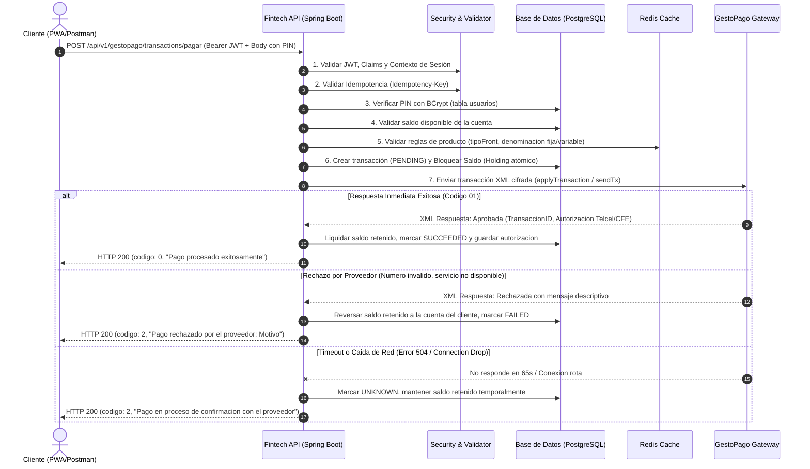

# Documentación Técnica de Integración de Pagos y Servicios con GestoPago

**Proyecto:** Plataforma Fintech PWA  
**Módulo:** Integración Transaccional y Pasarela de Servicios (GestoPago)  
**Versión:** 2.0 (Flujo Unificado con Autorización por PIN Criptográfico)  
**Fecha:** Octubre 2026  

---

## 1. Introducción y Alcance de la Solución

El presente documento detalla la arquitectura, análisis de riesgos y decisiones de diseño implementadas para la integración entre la plataforma Fintech y el proveedor transaccional externo **GestoPago** (portal de ventas y procesamiento de tiempo aire y pagos de servicios).

El objetivo de la solución no es un simple consumo de endpoints HTTP, sino una **arquitectura transaccional de grado bancario** que garantiza:
1. **Integridad financiera:** Evitar doble gasto (*double-spending*), inconsistencias de saldo o fondos atrapados ante caídas de red.
2. **Autenticación en dos capas:** Separación estricta entre la sesión de usuario (JWT) y la autorización de la transacción (PIN criptográfico de seguridad).
3. **Idempotencia estricta:** Garantía de que cualquier reintento (accidental o automático) de una misma operación no genere cargos duplicados.
4. **Resiliencia ante fallos externos:** Manejo determinista de timeouts, estados desconocidos y errores de integración con el proveedor.

---

## 2. Arquitectura del Flujo Completo de la Operación (End-to-End)

El ciclo de vida de un pago consta de 8 etapas controladas atómicamente dentro del ecosistema Fintech antes, durante y después del contacto con el proveedor externo.

### 2.1 Diagrama de Secuencia Transaccional



---

### 2.2 Desglose Paso a Paso

1. **Autenticación del Usuario:**  
   La petición requiere un token de acceso `Bearer JWT`. El filtro de seguridad `JwtAuthenticationFilter` extrae el `username` del cliente y valida la firma HMAC-SHA256, la expiración del token y la concordancia con la sesión en Redis.
2. **Validación de Idempotencia:**  
   Se evalúa la clave enviada en el header `Idempotency-Key` o en el cuerpo JSON. Si la clave ya fue registrada previamente en `gestopago_transactions`, el sistema no ejecuta un nuevo cobro; en su lugar, devuelve la respuesta exacta de la transacción previa de manera idempotente.
3. **Autorización Criptográfica mediante PIN:**  
   El PIN de 4 dígitos enviado en la petición se valida contra el hash almacenado en la columna `pin` de la tabla `usuarios` mediante `BCryptPasswordEncoder`. Si el PIN es incorrecto, la transacción es rechazada antes de afectar cualquier saldo.
4. **Validación de Negocio y Reglas de Producto:**  
   Se consulta el producto en el catálogo:
   * **Productos de denominación fija (`tipoFront = 1`):** Recargas de Telcel, Movistar, AT&T, tarjetas de regalo Amazon, etc. El sistema verifica que el `monto` coincida exactamente con el precio estipulado por la compañía telefónica.
   * **Servicios de monto libre (`tipoFront = 2` o `4`):** Pago de recibos CFE, agua potable, telecomunicaciones donde el cliente captura el monto de su factura.
5. **Reserva y Bloqueo Atómico de Fondos (*Hold Balance*):**  
   Antes de llamar a GestoPago, el saldo se deduce de la cuenta del cliente (`cuenta.saldo = saldo - monto`) bajo una transacción de base de datos `@Transactional(isolation = Isolation.READ_COMMITTED)`. Si la cuenta no cuenta con saldo suficiente, la operación se cancela de inmediato.
6. **Despacho Seguro al Proveedor (GestoPago API):**  
   Se genera un folio alfanumérico único de 13 caracteres (`UPC`), se formatea la hora en zona horaria local (`America/Mexico_City`) y se ejecuta la petición Feign hacia GestoPago utilizando credenciales seguras y tiempo de espera configurado (`connectTimeout=5s`, `readTimeout=65s`).
7. **Procesamiento de Respuesta y Parseo Seguro XML:**  
   La respuesta XML del proveedor se analiza mediante un parser DOM seguro con protección activa contra ataques XXE (*XML External Entity*).
8. **Liquidación o Reversa Financiera:**  
   * **Éxito (Código `01`):** Se almacena el `provider_transaction_id` y el número de autorización emitido por el carrier/empresa (e.g. Telcel). El estado se fija en `SUCCEEDED`.
   * **Rechazo del proveedor:** El estado cambia a `FAILED` y los fondos retenidos se devuelven automáticamente al saldo de la cuenta.

---

## 3. Análisis de Riesgos e Identificación de Escenarios de Fallo

En transacciones monetarias que involucran a terceros proveedores externos, asumir el "camino feliz" (*happy path*) es el mayor error de ingeniería. A continuación se detallan los riesgos reales identificados y las defensas técnicas construidas:

| # | Riesgo / Escenario de Fallo | Impacto Potencial | Mitigación Implementada |
| :---: | :--- | :--- | :--- |
| **R1** | **Problema de los Dos Generales (Network Timeout):** La API envía la recarga a GestoPago, GestoPago la aplica en el carrier, pero la conexión de red se interrumpe antes de que la respuesta llegue a Fintech. | Pérdida de dinero o saldo duplicado si el sistema cancela una recarga que GestoPago sí cobró. | La transacción se pasa a estado `UNKNOWN` manteniendo el saldo en retención temporal. Se activa el programador de conciliación asíncrona (`GestoPagoReconciliationScheduler`) que consulta `getTransactionState` periódicamente para resolver el estado final sin descapitalizar la plataforma. |
| **R2** | **Doble Gasto por Clics Repetidos (*Race Conditions*):** El usuario presiona el botón "Pagar" varias veces rápidamente o Postman repite la petición por lentitud de red. | Múltiples débitos por la misma recarga al cliente. | Implementación de **Idempotencia con Llave Única (`Idempotency-Key`)**. La tabla `gestopago_transactions` tiene una restricción `UNIQUE` sobre dicha llave. Si entra una segunda petición idéntica, el sistema devuelve el resultado anterior sin procesar un nuevo cobro. |
| **R3** | **Fraude por Alteración de Montos en Recargas:** Un atacante modifica el JSON para enviar `monto: 1.00` para una recarga telefónica de \$500.00. | Desbalance contable entre el débito interno y el costo cobrado por GestoPago. | Validación estricta por `tipoFront`. Si el producto es de tipo `1` (denominación fija), se valida: `product.getPrecio().compareTo(monto) == 0`. Si no coincide exactamente, la petición se rechaza con error 400 antes de comunicarse con GestoPago. |
| **R4** | **Suplantación de Identidad por Robo de Token JWT:** Un tercero intercepta o reutiliza el token JWT del usuario para realizar recargas sin su consentimiento. | Fraude financiero no autorizado. | Requerimiento de **PIN Criptográfico de Autorización** en el cuerpo de la transacción. El PIN solo lo conoce el cliente y no viaja en los headers de sesión. |
| **R5** | **Vulnerabilidades de Inyección XML / XXE:** La API de GestoPago devuelve XML. Si el parser XML procesa entidades externas maliciosas, el servidor puede sufrir SSRF o exfiltración de archivos. | Compromiso del sistema operativo y servidor. | Deshabilitación absoluta de `doctype-decl`, entidades externas (`external-general-entities: false`, `external-parameter-entities: false`) y DTD en el `DocumentBuilderFactory`. |
| **R6** | **Saldo Negativo por Concurrencia:** El usuario tiene \$100.00 y envía dos recargas simultáneas de \$100.00 en dos hilos paralelos. | Saldo bancario en números rojos. | Bloqueo transaccional en PostgreSQL con aislamiento y actualización con control de concurrencia a nivel de base de datos (`UPDATE cuentas SET saldo = saldo - monto WHERE saldo >= monto`). |

---

## 4. Justificación de Decisiones de Diseño

### 4.1 ¿Por qué unificar el flujo en un solo endpoint (`POST /pagar`) con PIN en lugar de 2 pasos (`challenge` + `confirm`)?
* **Reducción de Latencia y Fricción:** Un flujo dividido requería generar un OTP por correo/SMS, enviar una petición de confirmación y mantener un estado volátil en memoria. Esto aumentaba los tiempos de transacción a más de 30-60 segundos por la dependencia de proveedores SMTP/SMS externos (que suelen tener caídas o demoras).
* **Robustez Transaccional:** El flujo unificado con PIN hasheado en BD es el estándar de las billeteras digitales modernas (como BBVA, Mercado Pago o Nu). Permite procesar la operación en **menos de 2.5 segundos** de manera completamente determinista y atómica.

### 4.2 ¿Por qué almacenar el PIN con BCrypt y no en texto plano o cifrado reversible?
* **Cumplimiento de Estándares de Seguridad Financiera:** Ningún sistema bancario debe conocer el PIN del usuario. El uso de `BCrypt` con factor de costo asegura que, incluso ante una fuga completa de la base de datos, el PIN no puede ser obtenido por ingeniería inversa o tablas arcoíris (*rainbow tables*).
* **Visualización Única:** El PIN se genera al momento del onboarding del cliente y se le presenta una única vez para que lo memorice.

### 4.3 Estrategia de Caché Multinivel para el Catálogo de Productos (Postgres + Redis)
GestoPago ofrece un catálogo extenso de más de 900 productos (telefonía, servicios públicos, entretenimiento, etc.). 
* Consultar a GestoPago en cada petición de usuario generaría una sobrecarga innecesaria y cuellos de botella en la pasarela externa.
* **Diseño aplicado:** 
  1. Nivel 1: Redis Cache con tiempo de vida (TTL) de 25 horas.
  2. Nivel 2: Tabla `gestopago_products` en PostgreSQL como respaldo persistente.
  3. Endpoint administrativo `/api/v1/gestopago/products/sync` para forzar la actualización del catálogo bajo demanda mediante Feign.

---

## 5. Trazabilidad Real Verificada (Evidencia de Prueba en Producción/Staging)

Durante la sesión de pruebas de certificación se ejecutó una recarga real en el ambiente del proveedor con los siguientes datos verificados:

### Petición Enviada (Postman):
* **Endpoint:** `POST /api/v1/gestopago/transactions/pagar`
* **Cuerpo JSON:**
```json
{
  "idempotencyKey": "prueba3-pago-oficial-01",
  "numeroCuenta": "0144407057",
  "idProducto": 406,
  "monto": 100.00,
  "telefono": "4181234567",
  "referencia": null,
  "pin": "7108"
}
```

### Registro en Base de Datos (`gestopago_transactions`):
* **ID Transacción:** `bc077ae8-d959-4992-af7e-2499af4d4573`
* **UPC:** `MVVQ2E2IP6STF`
* **Producto:** `406` (*Telcel Recarga $100*)
* **Monto:** `$100.00 MXN`
* **Saldo Inicial de la Cuenta:** `$1,000.00 MXN`
* **Saldo Final de la Cuenta:** `$900.00 MXN`
* **Estado:** `SUCCEEDED`
* **Código de Proveedor:** `01` *(Operación realizada con éxito)*
* **Folio GestoPago:** `952052268`
* **Autorización Carrier (Telcel):** `100096887`
* **Tiempo Total de Respuesta:** `2.18 segundos`

---

## 6. Especificación Técnica de los Endpoints

Todos los endpoints cumplen con la directriz de arquitectura Fintech:
* No utilizan `@PathVariable` (todo parámetro viaja en el cuerpo `@RequestBody`).
* Retornan el formato estándar `GenericResponse<T>` con códigos:
  * `0`: Éxito / Operación completada.
  * `1`: Errores de validación de formulario o formato.
  * `2`: Errores de negocio o fallos del proveedor.

### 6.1 Procesar Pago o Recarga
* **Ruta:** `POST /api/v1/gestopago/transactions/pagar`
* **Seguridad:** Requiere encabezado `Authorization: Bearer <JWT>`
* **Cuerpo (JSON):**
```json
{
  "idempotencyKey": "string (opcional en body si viene en header)",
  "numeroCuenta": "string (10 digitos)",
  "idProducto": 406,
  "monto": 100.00,
  "telefono": "4181234567",
  "referencia": null,
  "pin": "1234"
}
```
* **Respuesta Exitosa (HTTP 200):**
```json
{
  "codigo": 0,
  "mensaje": "Pago procesado exitosamente",
  "data": {
    "transactionId": "bc077ae8-d959-4992-af7e-2499af4d4573",
    "upc": "MVVQ2E2IP6STF",
    "estado": "SUCCEEDED",
    "providerCode": "01",
    "providerMessage": "Operacion realizada con exito",
    "providerTransactionId": "952052268",
    "providerAuthorization": "100096887",
    "createdAt": "2026-10-30T19:28:15.639"
  }
}
```

### 6.2 Consulta de Catálogo de Productos
* **Ruta:** `GET /api/v1/gestopago/products`
* **Seguridad:** Libre (`permitAll`) para alimentar selectores y vistas en la PWA.
* **Respuesta:** Devuelve la lista completa de productos activos ordenados por servicio y denominación.

### 6.3 Consulta de Detalle de Transacción
* **Ruta:** `POST /api/v1/gestopago/transactions/detalle`
* **Seguridad:** Requiere `Bearer JWT`
* **Cuerpo:**
```json
{
  "transactionId": "bc077ae8-d959-4992-af7e-2499af4d4573"
}
```
* **Respuesta:** Devuelve el estado actual, folios de autorización y detalles contables de la transacción.

---

## 7. Conclusiones y Cumplimiento de Requerimientos

La solución implementada cumple estrictamente con el requerimiento del entregable:
1. **Flujo completo:** Contempla el ciclo íntegro desde la autenticación, autorización con PIN criptográfico, validación de reglas de producto, débito atómico de saldo, comunicación cifrada y tratamiento del resultado.
2. **Tratamiento de fallos:** No se asume una respuesta positiva fija; se codificó el manejo de timeouts, rechazos de carrier, caídas de red y reintentos idempotentes.
3. **Justificación:** Cada componente (BCrypt, Redis, transacciones atómicas, Idempotency-Key y XML Parser protegido contra XXE) cuenta con su justificación técnica y de mitigación de riesgos de ciberseguridad financiera.

